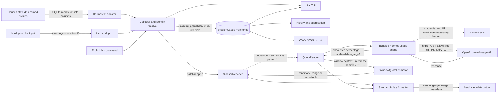

# アーキテクチャ

通常の収集経路はHermesのSQLite DBとherdrのPane情報を読み、確かなSession ID対応だけを独自monitor DBへ保存します。任意のquota照会はこの経路から分離され、明示的に有効化したときだけ動きます。



## 通常の収集と保存

- `HermesDB` はPython標準ライブラリのsqlite3でDBを `mode=ro` 接続し、安全な列allowlistだけを読みます。HermesのアプリケーションDB APIをimportせず、migrationを起こしません。
- herdrの機械可読Pane一覧が報告する正確なHermes Session IDを照合します。cwdやタイトルは表示情報で、identity resolverの根拠にはしません。
- DB identityとSession IDを組み合わせてprofileを区別します。ID衝突や複数Pane競合など曖昧な場合は `unlinked` / `unattributed` とし、推測で割り当てません。
- 通常の収集データの永続化先は独自monitor DBです。sidebarを有効にした場合は別途herdrへmetadataを送信します。初回値はbaselineとして保存し、後続の累計値との差を観測区間のusageとして集計します。
- messages、system prompt、tool argumentsは収集しません。通常の収集は外部通信やtelemetryを行いません。

## macOS autostart

```mermaid
sequenceDiagram
    participant H as herdr plugin startup
    participant A as short launchctl start action
    participant L as LaunchAgent
    participant M as SessionGauge managed monitor
    participant O as OS monitor lease
    H->>A: start (one-shot)
    A->>L: launchctl bootstrap / kickstart
    L->>M: foreground Python process
    M->>O: acquire data-dir + socket lease
    M->>M: readonly herdr status check; backoff/reconnect
```

startup hookはHerdr SERVERの起動・handoff時だけで、client attach/detachではありません。server未準備ならmonitor DB/quotaを起動せずdeferし、動作中の一時切断ではmonitorがscope leaseを維持して既存Collectorのbackoffに任せます。

## 任意のquota経路

サイドバー報告には `[sidebar] enabled = true` が必要で、quota照会は独立して `[sidebar.quota] enabled = true` も必要です。`Collector` から `SidebarReporter`、formatterを経てherdrへmetadataを送ります。quotaが有効で対象が適格な場合だけ、`SidebarReporter` が `QuotaReader` を呼び、Hermes SDK用Pythonでbundled `hermes_usage_bridge.py` を起動します。bridgeは既存helperを通じてHermes SDKのcredential resolverとURL resolverを利用します。`hermes_root` はSDKのコード配置、`hermes_home` はSDKが使うprofile/home、`hermes_python` はそのSDK環境のPythonを指し、それぞれ別の設定です。

bridgeはhttpxで `thread_usage/query_v2` へのHTTPS POSTを行い、`chatgpt.com` と `api.openai.com` の許可済みhostに限定します。推定経路では同じ認証情報・hostでaccount GETも行い、`rate_limit.primary_window.reset_at` と18000秒の長さだけを使います。account IDとplanはopaqueなscope hashにし、使用率をアカウント全体から各SIDへ複製しません。thread本文にはSID、開始時刻、空のdescendant ID一覧だけを含みます。current SIDに加え、同一profileの履歴から最大3件のroot SIDを参照候補にできます。会話本文・タイトル・cwd・token数・modelは送信しません。raw responseや参照contextはmonitor DB・exportへ保存しません。推定値は条件付き範囲です。`data_as_of` が各行の正確な完了cutoffであることや5時間枠の意味は上流保証ではありません。

`QuotaHistory` はprofileで限定したmonitor DBを `mode=ro` / `query_only` で読み、SDK側DBのmodel情報も一意な単一model確認に限って読みます。API timestampの前後のsnapshotで参照bucketを括り、window開始時刻も括って現在値との差分範囲を作ります。履歴DBへAPI値や推定contextは書きません。参照・windowの不整合や鮮度切れはN/Aです。`WindowQuotaEstimator` は非同期の単一workerで照会し、pending中は前回contextの有効期間を超えて表示しません。

通常の収集に新たな依存はなく、quota bridgeはHermes SDK環境にすでにあるSDKとhttpxを利用します。quota経路は外部通信を行うため、通常のローカル収集とは異なるopt-inの境界です。

bridgeの監査ガードは `.env` / `.env.*` と `.ssh` へのopenを拒否し、相対パスも拒否します。これは子プロセス内の防御層で、OS sandboxではありません。SDK配置や認証helperの選択をSessionGaugeがOS権限境界として強制するものでもありません。

## サイドバー報告

sidebar reporterはPaneの現在状態とSession IDを再確認し、一意に対応するPaneだけにnamespaced `sessiongauge_usage` tokenをTTL付きmetadataとして送信します。終了時や対象消失時にSessionGaugeが所有するtokenをclearします。`estimate` modeは条件付き範囲を `~lower–upper%`、ほぼ一点の範囲を `~x%`、上限不定を `~≥lower%` と表示し、信頼できる参照等がなければN/Aです。`api` modeはprovider raw task budgetを `API` ラベル付きで表示します。`percent_tokens` はローカルtoken数を任意で併記します。herdr側の行設定は利用者が行います。

## 集計上の扱い

- 既存表示の `total_tokens` は `input_tokens + output_tokens`。推定用canonical bucketはuncached input、cache read、cache write、outputの独立4区分で、reasoningはoutputに含まれます。
- 観測開始前の使用量は復元しません。観測区間の差分はminimum observedで、未観測時間へ按分しません。
- 欠損値はゼロとせず `N/A` 相当として扱います。estimated costとactual costは別です。
- 日付境界をまたぐ区間、または安全に一意なTaskへ割り当てられない区間は推定配賦しません。
