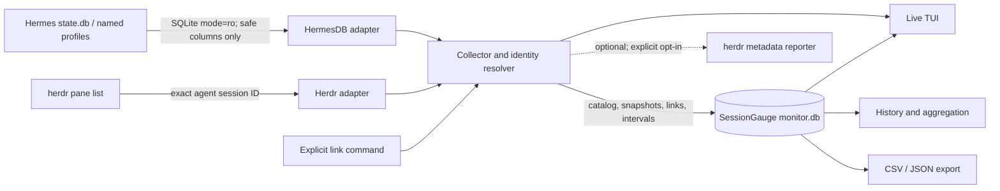

# アーキテクチャ

SessionGaugeはローカルのHermes SQLite DBを読み取り、herdrのPane情報とSession IDを照合します。確認済みのリンクと観測差分を独立した監視DBへ保存し、ライブ表示・履歴・エクスポートに利用します。

## データ境界

- Hermes DBはPython標準ライブラリのsqlite3を `mode=ro` で開き、実行時に列を検出します。Hermesのmigrationを起こし得るアプリケーション用DB APIはimportしません。
- セッションID、モデル、利用量、コスト、時刻、および利用可能なプロジェクト情報など、必要な列だけを読みます。messagesやsystem prompt、ツール引数、APIキーは取得しません。
- herdrの機械可読Pane一覧から公式integrationが報告する正確なHermes Session IDを使います。cwdやタイトル等は表示・補助情報であり、自動リンク根拠にしません。
- SessionGaugeが書き込むのは独自monitor DBだけです。既定の保存先は `~/.local/share/sessiongauge/monitor.db` で、所有者限定権限を使います。
- 外部通信やテレメトリはありません。サイドバー報告を明示的に有効化した場合のみ、herdr CLIへローカルmetadataを送ります。

## 照合と永続化

CollectorはPane情報とprofile別のSessionカタログを照合します。DB identityとSession IDを組にして扱うため、異なるprofileの同じIDは混同しません。公式ID、既に保存された関係、利用者の明示リンクを根拠にします。曖昧なID衝突や複数Pane競合は自動帰属させず、unlinked / unattributedとして残します。

monitor DBにはprofile、task、Pane/Session link、session catalog、累積snapshot、観測区間のusage attributionおよびeventを保存します。初回観測はbaselineであり期間内の増加として数えません。後続の累積値との差を区間値として保存し、履歴は区間値を集計します。観測できない過去の利用量は復元しません。

## 集計と表示

- `total_tokens` は `input_tokens + output_tokens`。Cache/Reasoningを追加で合算しません。
- ライブ表示は累計、最新の観測差分、直近60秒に終了した観測区間の差分（`recent_60s`）を提供します。未観測時間を補間せず、値はminimum observedです。
- Paneの明示タイトルを優先します。汎用的なHermes端末タイトルの場合のみ、確定照合されたSessionのタイトルを表示名に使います。タイトル/cwdはidentity resolverへ渡す照合根拠ではありません。実効表示名の変更はPane title eventに記録します。
- 欠損値は0とせず `N/A` 相当として扱います。estimated costとactual costは別項目です。
- 期間境界をまたぐ区間や、日別集計でローカル午前0時をまたぐ区間は、日付への推定配賦をせず除外してlower boundと注記します。
- セッション再開、compressionによる分岐、Pane移動などで安全に区間を一意なタスクへ帰属できないデータはunattributedです。
- 変更のない終了済みSessionは新しいsnapshotを繰り返し追加しません。catalogは最後に取得した情報を保持します。
- TUIは標準ライブラリのcursesとバックグラウンドcollectorを使います。CLIはargparse、DBはsqlite3、設定はtomllibを使い、ランタイム依存を持ちません。

## サイドバー連携

オプトイン時、reporter固有source、単調増加sequence、TTL付き `sessiongauge_usage` tokenを使います。送信前にPaneの現在状態とSession IDの一致を再確認し、曖昧な対応は報告しません。終了時や対象消失時に所有tokenだけをclearする設計です。herdr側のサイドバー行設定は利用者が行います。送信と表示は別の機能境界であり、実機の描画は未検証です。
